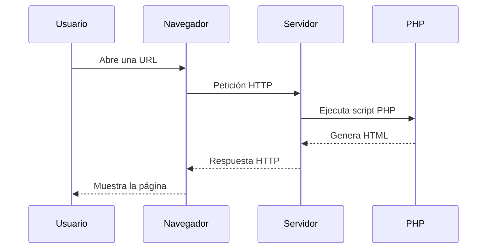
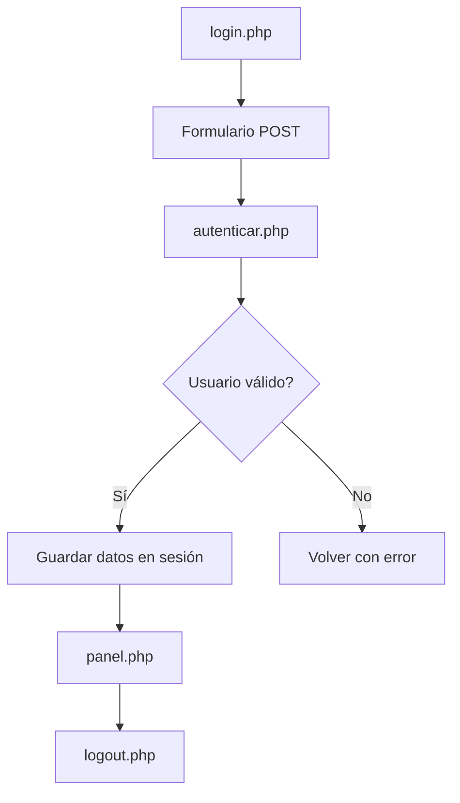

# Apuntes · Programación web en servidor con PHP

## 1. Antes de empezar: qué vas a aprender de verdad aquí

Esta unidad no trata de memorizar sintaxis de PHP como si fuera una lista de reglas sueltas.  
Lo importante es entender este proceso:

1. un usuario abre una URL o envía un formulario;
2. el navegador manda una petición HTTP al servidor;
3. el servidor ejecuta código PHP;
4. ese código toma decisiones;
5. el servidor devuelve una respuesta, normalmente HTML.

Si entiendes bien ese ciclo, luego todo encaja:
- variables,
- formularios,
- funciones,
- sesiones,
- login,
- y en la siguiente UT, base de datos.

---

## 2. Cómo realizar y entregar los mini ejercicios

Sigue este procedimiento para desarrollar y probar los mini ejercicios de esta unidad.

### 1. Prepara el entorno de ejercicios

En tu repositorio de entregas, copia la carpeta `unidades/UT1/ut1-entorno-web` dentro de `unidades/UT2/`. Después, renombra la copia a `ut2-ejercicios`.

La estructura de trabajo debe quedar así:

```text
unidades/
└── UT2/
    ├── ejercicios.md
    └── ut2-ejercicios/
        └── app/
```

No modifiques ni elimines la carpeta original de la UT1. La copia de UT2 será el entorno que usarás durante esta unidad.

### 2. Crea los programas PHP

Desde el mini ejercicio 3 hasta el 18, crea un fichero PHP para cada ejercicio dentro de `unidades/UT2/ut2-ejercicios/app/`. Usa nombres claros que permitan identificar cada ejercicio, por ejemplo:

```text
app/
├── ejer-03.php
├── ejer-04.php
├── ...
└── ejer-18.php
```

Escribe en cada fichero el programa solicitado y comprueba que funciona antes de continuar con el siguiente.

### 3. Prueba los programas

Arranca el entorno de `ut2-ejercicios` igual que hiciste en la UT1. Después, abre en el navegador la URL correspondiente a cada fichero que hayas creado dentro de `app/` y comprueba el resultado.

Cuando un ejercicio incluya HTML, revisa que la página se vea correctamente. Cuando solo pida código PHP, comprueba igualmente que el servidor ejecuta el script y muestra el resultado esperado.

### 4. Completa `ejercicios.md`

El fichero `unidades/UT2/ejercicios.md` solo debe contener las respuestas escritas de:

- los mini ejercicios 1 y 2;
- el mini ejercicio 19;
- las actividades finales de repaso 20 a 24;
- los apartados **Dificultades encontradas** y **Uso de la IA**.

No copies en `ejercicios.md` el código de los mini ejercicios 3 a 18: entrégalo en los ficheros PHP de `ut2-ejercicios/app/`.

---

## 3. ¿Qué es un lenguaje de guiones de servidor?

Un **lenguaje de guiones de servidor** es un lenguaje que se ejecuta **en el servidor**, no en el navegador del usuario.

Su misión es generar una respuesta dinámica a partir de una petición.

### Algunos lenguajes de servidor relevantes

Los más conocidos en el entorno web son, entre otros:

- **PHP**
- **JavaScript en servidor** con Node.js
- **Python** con frameworks como Django o Flask
- **Ruby** con Ruby on Rails
- **Java** con Spring u otras tecnologías empresariales
- **C#** con ASP.NET

### ¿Por qué trabajamos con PHP en esta UT?

Porque PHP cumple muy bien lo que necesitamos aquí:

- está muy extendido en entornos web;
- se integra de forma natural con HTML;
- permite empezar con ejemplos sencillos muy rápido;
- es ideal para entender el modelo petición-respuesta;
- sigue siendo muy usado en aplicaciones reales y en muchos CMS.

### Idea importante
No estamos estudiando “el mejor lenguaje del mundo”.  
Estamos estudiando un lenguaje muy útil para entender cómo funciona la programación web en servidor.

---

### Mini ejercicio 1
Responde por escrito con una frase a cada pregunta:

1. ¿Qué significa que un lenguaje sea “de servidor”?  
2. Nombra tres lenguajes de servidor distintos de PHP.  
3. ¿Por qué tiene sentido empezar con PHP en esta unidad?

---

## 4. Cliente y servidor: no hacen lo mismo

Este es el punto más importante de toda la UT.

### El cliente
El **cliente** suele ser el navegador del usuario.

Interpreta:
- HTML
- CSS
- JavaScript

Muestra la interfaz y permite interactuar con ella.

### El servidor
El **servidor** recibe peticiones HTTP y devuelve respuestas HTTP.

En nuestro caso, además:
- ejecuta PHP;
- procesa formularios;
- valida datos;
- decide qué respuesta enviar.

### Lo que no debes confundir
- **HTML** describe la estructura de la página.
- **PHP** calcula y genera contenido antes de que la página llegue al navegador.

### Esquema mental correcto



### Una metáfora útil
Piensa en un restaurante:

- el **cliente** es quien pide;
- el **servidor** sería como la cocina;
- **PHP** es el proceso de preparación;
- lo que vuelve a la mesa es el plato terminado.

El cliente no entra a la cocina a ejecutar nada.  
Recibe el resultado ya preparado.

### Ejemplo de error mental típico
Un alumno ve esto:

```php
<?php
$nombre = 'Victoria';
echo "<h1>Hola, $nombre</h1>";
```

Y piensa: “El navegador leerá PHP”.

No. El navegador no recibe eso. El navegador recibe algo como esto:

```html
<h1>Hola, Victoria</h1>
```

---

### Mini ejercicio 2
Imagina que un formulario pide nombre y correo. Explica con tus palabras:

1. quién envía la petición;
2. quién procesa los datos;
3. quién muestra la página final.

---

## 5. PHP dentro del entorno de trabajo de la UT1

En la UT1 dejaste preparado un entorno reproducible para trabajar con aplicaciones web.  
En esta UT ese entorno cobra mucho sentido, porque PHP necesita ejecutarse en un servidor o en un entorno que haga ese papel.

### Herramientas que usaremos

- **VS Code** para editar archivos.
- **El entorno montado en UT1** para ejecutar la aplicación.
- **PHP** como lenguaje de servidor.
- **El navegador** para probar resultados.
- **Logs y depuración básica** para localizar errores.

### Formas habituales de ejecutar PHP en esta UT

#### Opción A. Entorno reproducible de la UT1
Entorno web en el que cada servicio se despliega en un contenedor:
- servidor web (Nginx)
- runtime (PHP-FPM)
- base de datos (MariaDB) 

Ventajas:
- se parece más a un entorno real;
- todos trabajan sobre una base común;
- evita diferencias entre equipos.

#### Opción B. Servidor embebido de PHP
Para ejemplos rápidos:

```bash
php -S localhost:8000
```

Ventajas:
- es sencillo;
- arranca rápido;
- va muy bien para pruebas pequeñas.

### Estructura básica de un proyecto PHP sencillo

```text
mi-proyecto-php/
├── index.php
├── login.php
├── panel.php
├── logout.php
└── includes/
    ├── funciones.php
    └── usuarios.php
```

### Qué conviene hacer siempre en VS Code

- trabajar con una carpeta de proyecto, no con archivos sueltos;
- nombrar bien los archivos;
- separar código reutilizable en `includes/` si hace falta;
- probar muy a menudo;
- guardar y recargar el navegador con frecuencia.

### Buena práctica
Haz cambios pequeños y compruébalos enseguida.  
Cuando un alumno escribe 80 líneas sin probar nada, el error final suele costar mucho más de localizar.

---

## 6. Primer contacto con PHP

## 6.1. Etiquetas de apertura

PHP se escribe dentro de estas etiquetas:

```php
<?php
// código PHP
```

En muchos archivos modernos se usa solo la apertura y luego HTML si hace falta.  
No es obligatorio cerrar con `?>` en archivos que solo contienen PHP.

### Primer ejemplo

```php
<?php

echo 'Hola desde PHP';
```

### Qué hace `echo`
`echo` envía texto a la salida. En una aplicación web, normalmente esa salida acaba formando parte del HTML que recibirá el navegador.

---

## 6.2. Mezclar PHP y HTML

Una de las razones por las que PHP es tan útil en iniciación es que se mezcla muy bien con HTML.

```php
<?php
$titulo = 'Mi primera página dinámica';
?>
<!DOCTYPE html>
<html lang="es">
<head>
    <meta charset="UTF-8">
    <title><?php echo $titulo; ?></title>
</head>
<body>
    <h1><?php echo $titulo; ?></h1>
    <p>Esta página ha sido generada con PHP.</p>
</body>
</html>
```

### Qué está pasando aquí
- PHP calcula el valor de `$titulo`.
- Después inserta ese valor dentro del HTML.
- El navegador solo verá el HTML final.


---

## 6.3. Comentarios

```php
<?php
// Comentario de una línea

# También válido, aunque se usa menos

/*
   Comentario
   de varias líneas
*/
```

Los comentarios sirven para aclarar el código, no para sustituir nombres mal puestos.

Mal ejemplo:

```php
$aa = 5; // número de meses del contrato introducido por el usuario en el formulario principal
```

Mejor ejemplo:

```php
$mesesContrato = 5;
```

---

### Mini ejercicio 3
Crea un archivo `hola.php` que muestre:

- un título con tu nombre,
- un párrafo diciendo que la página se genera en servidor,
- y la fecha del día usando PHP.

---

## 7. Variables, tipos de datos y operadores

## 7.1. Variables

En PHP, las variables empiezan por `$`.

```php
<?php
$nombre = 'Lucía';
$edad = 19;
$activo = true;
```

### Regla importante
El nombre de una variable debe ayudarte a entender qué contiene.

Mejor:

```php
$correoUsuario = 'alumno@centro.es';
```

Peor:

```php
$c = 'alumno@centro.es';
```

### Qué conviene evitar
- nombres crípticos;
- mezclar español e inglés sin criterio;
- nombres demasiado genéricos como `$dato`, `$valor`, `$cosa`.

---

## 7.2. Tipos básicos

En esta UT nos bastan estos tipos:

- **string**: texto
- **int**: enteros
- **float**: decimales
- **bool**: verdadero o falso
- **array**: colección de valores
- **null**: ausencia de valor

### Ejemplos

```php
<?php
$nombre = 'Aitana';      // string
$edad = 21;              // int
$precio = 9.99;          // float
$autenticado = false;    // bool
$extras = ['backup', 'soporte']; // array
$ultimoAcceso = null;    // null
```

### Importante para principiantes
No te obsesiones al principio con “tipar todo perfectamente”.  
Lo importante aquí es saber qué tipo de dato estás manejando y qué sentido tiene en tu lógica.

---

## 7.3. Concatenación e interpolación

### Concatenar con `.`

```php
<?php
$nombre = 'Mario';
echo 'Hola, ' . $nombre;
```

### Interpolar dentro de comillas dobles

```php
<?php
$nombre = 'Mario';
echo "Hola, $nombre";
```

### Recomendación
Ambas formas son válidas.  
Para empezar, la interpolación suele resultar muy cómoda en ejemplos simples.

---

## 7.4. Operadores frecuentes

### Aritméticos

```php
<?php
$total = 10 + 5;
$descuento = 20 - 3;
$importe = 4 * 6;
$media = 9 / 3;
$resto = 10 % 3;
```

### Comparación

```php
<?php
$esMayor = $edad >= 18;
$coincide = $usuario === 'ana';
```

### Lógicos

```php
<?php
$accesoPermitido = $autenticado && $rol === 'admin';
```

### `===` frente a `==`
En iniciación, conviene acostumbrarse a usar `===` cuando quieres comparar valor y tipo de forma estricta.

---

## 7.5. Arrays

Los arrays son muy útiles en web.

### Array indexado

```php
<?php
$planes = ['Básico', 'Profesional', 'Empresa'];
```

### Array asociativo

```php
<?php
$usuario = [
    'nombre' => 'Ana',
    'correo' => 'ana@empresa.es',
    'rol' => 'cliente'
];
```

### Acceso a datos

```php
<?php
echo $planes[0];
echo $usuario['nombre'];
```

### ¿Por qué son importantes aquí?
Porque en esta UT los usarás para:
- listar opciones de formularios;
- almacenar errores;
- agrupar datos de usuarios;
- guardar información en sesión.

---

### Mini ejercicio 4
Crea un array asociativo con datos de un servicio web:

- nombre,
- precio mensual,
- si incluye dominio (booleano),
- si incluye soporte (booleano).

Después muestra esos datos dentro de una lista HTML.
De momento, los booleanos se muestran como el valor 1 (true) y el valor 0 (false).

---

OPCIONAL: Si quieres seguir practicando ejercicios sobre tipos básicos, accede al siguiente [Enlace](ejer_ampliacion/ejer_basicos.md)

---

## 8. Estructuras de control

Las estructuras de control permiten que el programa tome decisiones o repita acciones.

Sin ellas, PHP solo sería una calculadora de líneas sueltas.

---

## 8.1. `if`, `elseif`, `else`

### Ejemplo 1

```php
<?php
$edad = 17;

if ($edad >= 18) {
    echo 'Acceso permitido';
} else {
    echo 'Acceso no permitido';
}
```

### Ejemplo 2

```php
<?php
$plan = 'Profesional';

if ($plan === 'Básico') {
    $precio = 5;
} elseif ($plan === 'Profesional') {
    $precio = 9;
} else {
    $precio = 15;
}
```

### Error típico
Olvidar que una condición compara, no asigna.

Incorrecto:

```php
if ($plan = 'Básico') {
```

Eso asigna, no compara.  
Lo correcto sería:

```php
if ($plan === 'Básico') {
```

---

### Mini ejercicio 5
Crea una variable `$espacioLibreGb` y le asignas un número que represente el espacio libre de un servidor en Gb. Muestra uno de estos mensajes:

- `Espacio crítico` si es menor de 5 GB.
- `Espacio limitado` si está entre 5 y 20 GB, ambos incluidos.
- `Espacio suficiente` si es mayor de 20 GB.

Usa `if`, `elseif` y `else`.
Céntrate en escribir bien el código PHP y no hace falta que incluyas  HTML.

---

### Mini ejercicio 6
Una aplicación tiene una variable `$mantenimientoActivo` de tipo booleano. Muestra:

- `La aplicación está en mantenimiento` si su valor es `true`.
- `La aplicación está disponible` si su valor es `false`.

Después prueba el código con ambos valores.
Escribe solo el código PHP.

---

### El Operador Ternario (`?:`) en PHP

El **operador ternario** es una forma compacta de escribir una estructura condicional `if-else` en una sola línea de código. Se utiliza principalmente para asignar valores rápidamente según se cumpla o no una condición.

```php
$variable = (condición) ? valor_si_es_verdadero : valor_si_es_falso;
```

Imagina que quieres comprobar si un usuario ha iniciado sesión para guardar un mensaje de bienvenida:

**Con `if-else` tradicional:**
```php
if ($usuario_logueado) {
    $mensaje = "¡Hola de nuevo!";
} else {
    $mensaje = "Bienvenido, invitado";
}
```

**Con el operador ternario (más limpio y compacto):**
```php
$mensaje = ($usuario_logueado) ? "¡Hola de nuevo!" : "Bienvenido, invitado";
```

---

## 8.2. `switch`

Es útil cuando comparas una misma variable contra varios casos.

```php
<?php
$plan = 'Empresa';

switch ($plan) {
    case 'Básico':
        $precio = 5;
        break;
    case 'Profesional':
        $precio = 9;
        break;
    case 'Empresa':
        $precio = 15;
        break;
    default:
        $precio = 0;
}
```

### Cuándo usar `switch`
Cuando mejora la legibilidad respecto a varios `if/elseif` seguidos.

---

### Mini ejercicio 7
Guarda en `$estadoHttp` uno de estos códigos: `200`, `404` o `500`. Usa `switch` para mostrar un mensaje adecuado para cada caso. Incluye también un `default` para códigos no previstos. Escribe solo el código PHP.

---

### Mini ejercicio 8
Guarda en `$accion` una de estas operaciones de administración: `reiniciar`, `detener` o `estado`. Usa `switch` para mostrar qué haría el sistema mediante una frase con un servicio web en cada caso. Escribe solo el código PHP.

---

## 8.3. `for`

El bucle `for` es útil cuando conoces bien cuántas repeticiones quieres.

```php
<?php
for ($i = 1; $i <= 5; $i++) {
    echo "<p>Línea $i</p>";
}
```

---

### Mini ejercicio 9
Usa un bucle `for` para mostrar los nombres de cinco copias de seguridad: `backup-1.sql` hasta `backup-5.sql`, cada una dentro de un elemento `<li>`.

---

### Mini ejercicio 10
Una aplicación debe crear tres usuarios de prueba. Usa un bucle `for` para mostrar los nombres `usuario1`, `usuario2` y `usuario3` dentro de etiquetas de párrafo HTML.

---

## 8.4. `while`

El bucle `while` es útil cuando repites algo mientras se cumpla una condición.
Hay que acordarse de modificar la variable que se comprueba en la condición del bucle, de lo contrario, podríamos incurrir en un bucle infinito.

```php
<?php
$contador = 1;

while ($contador <= 3) {
    echo "<p>Intento $contador</p>";
    $contador++;
}
```


---

### Mini ejercicio 11
Simula tres intentos de conexión a una base de datos con un bucle `while`. Muestra `Intento de conexión 1`, `Intento de conexión 2` e `Intento de conexión 3`, cada mensaje dentro de etiquetas de párrafo HTML.

---

### Mini ejercicio 12
Un servidor tiene 100 GB de espacio libre y cada copia de seguridad consume 20 GB. Usa un bucle `while` para mostrar el espacio disponible después de cada copia hasta que queden 20 GB o menos. Cada mensaje debe ir dentro de etiquetas de párrafo HTML.

---

## 8.5. `foreach`

Es una de las estructuras repetitivas más útiles en esta UT. 
Se suele utilizar para recorrer arrays.

```php
<?php
$errores = ['El nombre es obligatorio', 'El correo no es válido'];

foreach ($errores as $error) {
    echo "<li>$error</li>";
}
```

Con arrays asociativos:

```php
<?php
$usuario = [
    'nombre' => 'Ana',
    'correo' => 'ana@empresa.es'
];

foreach ($usuario as $clave => $valor) {
    echo "<p>$clave: $valor</p>";
}
```

### ¿Por qué es tan importante `foreach`?
Porque en aplicaciones web lo usarás continuamente para:
- mostrar listas de errores;
- recorrer opciones;
- imprimir tablas;
- leer datos agrupados.

---

### Mini ejercicio 13
Crea un array con tres mensajes de error y muéstralos dentro de una lista HTML usando `foreach`.

---

### Mini ejercicio 14
Crea un array asociativo con la configuración de una aplicación web: `entorno`, `depuracion` y `puerto`. Recorre el array con `foreach` y muestra cada clave y su valor dentro de un párrafo HTML. Define `depuracion` como un booleano y utiliza el operador ternario `? :` para mostrar los valores "Sí" o "No".

---

## 9. Funciones

Una función es un bloque de código reutilizable que hace una tarea concreta.

### ¿Por qué son importantes?
Porque evitan repetir lógica y ayudan a escribir programas más claros.

Piensa en una función como en una herramienta de una caja: no rehaces el martillo cada vez que quieres clavar un clavo.

---

## 9.1. Definir y usar una función

```php
<?php
function saludar(string $nombre): string
{
    return "Hola, $nombre";
}

echo saludar('Laura');
```

### Qué ves aquí
- `function saludar(...)` define la función;
- recibe un parámetro `$nombre`;
- devuelve un texto con `return`.
- la definición de la función NO ejecuta nada, debes llamar a la función para que se ejecute su código. En este caso se llama así: `saludar('Laura')`

### Si todavía no controlas bien los tipos
Puedes usar una versión más simple:

```php
<?php
function saludar($nombre)
{
    return "Hola, $nombre";
}
```

### Recomendación didáctica
En esta UT puedes mostrar ambos estilos, pero sin convertir el tipado en el centro de la unidad. Lo importante ahora es entender **qué problema resuelve una función**.

---

## 9.2. Ejemplo útil para la práctica

```php
<?php
function obtenerPrecioBase(string $plan): int
{
    switch ($plan) {
        case 'Básico':
            return 5;
        case 'Profesional':
            return 9;
        case 'Empresa':
            return 15;
        default:
            return 0;
    }
}

//Llamada a la función
$miPlan = 'Empresa';
echo "El precio de mi plan es: " . obtenerPrecioBase($miPlan);
```

Otra función:

```php
<?php
function calcularTotal(int $precioBase, int $meses, int $extras): int
{
    return ($precioBase + $extras) * $meses;
}

//Llamada a la función
echo "El total es: " . calcularTotal(100, 3, 15) . "€";
```

### Ventaja
Si mañana cambian los precios, sabes dónde tocar.  
No tendrás que revisar diez líneas dispersas.

---

## 9.3. Funciones para validar

```php
<?php
function esCorreoValido(string $correo): bool
{
    return filter_var($correo, FILTER_VALIDATE_EMAIL) !== false;
}
```

### Idea clave
No todas las funciones calculan números.  
Muchas funciones sirven para responder preguntas:
- ¿es válido este correo?
- ¿está autenticado el usuario?
- ¿existe este plan?

---

## 9.4. Buenas prácticas con funciones

Conviene que una función:
- haga una cosa concreta;
- tenga un nombre claro;
- reciba lo que necesita;
- devuelva un resultado útil.

### Mala función

```php
<?php
function cosas($a, $b, $c)
{
    // código confuso
}
```

### Mejor enfoque

```php
<?php
function calcularRecargoExtras(bool $backup, bool $soporte): int
{
    $recargo = 0;

    if ($backup) {
        $recargo += 2;
    }

    if ($soporte) {
        $recargo += 3;
    }

    return $recargo;
}
```

---

### Mini ejercicio 15
Escribe una función llamada `obtenerMensajePlan()` que reciba el nombre de un plan y devuelva un texto distinto para:

- Básico,
- Profesional,
- Empresa.

---

## 10. Formularios HTML y PHP

Aquí empieza la parte más web de toda la unidad.

Un formulario sirve para recoger datos del usuario.  
Pero el formulario por sí solo no basta. Hace falta que el servidor reciba esos datos y haga algo con ellos.

---

## 10.1. Anatomía mínima de un formulario

```html
<form action="procesar.php" method="post">
    <label for="nombre">Nombre</label>
    <input type="text" id="nombre" name="nombre">

    <button type="submit">Enviar</button>
</form>
```

### Elementos clave
- `action`: a qué archivo se enviarán los datos.
- `method`: cómo se enviarán (`get` o `post`).
- `name`: nombre con el que PHP recibirá ese dato.

### Error típico número 1
Pensar que `id` y `name` son intercambiables.

No.  
Para leer el dato en PHP, lo importante es `name`.

---

## 10.2. GET y POST

## GET
Los datos viajan en la URL.

Ejemplo:

```text
resultado.php?nombre=Ana&plan=Basico
```

### Cuándo encaja bien
- búsquedas;
- filtros;
- navegación donde tiene sentido compartir la URL.

## POST
Los datos viajan en el cuerpo de la petición.

### Cuándo encaja mejor
- formularios de envío;
- credenciales;
- datos que no deben aparecer en la URL;
- operaciones de creación o procesamiento.

### Regla práctica para esta UT
- usa **GET** para pruebas simples y consultas;
- usa **POST** para formularios principales, validación y login.

---

## 10.3. Leer datos con `$_GET` y `$_POST`

### Ejemplo con `GET`

Formulario:

```html
<form action="saludo.php" method="get">
    <input type="text" name="nombre">
    <button type="submit">Enviar</button>
</form>
```

Archivo `saludo.php`:

```php
<?php
$nombre = $_GET['nombre'] ?? '';
echo "Hola, $nombre";
```

### Ejemplo con `POST`

Formulario:

```html
<form action="procesar.php" method="post">
    <input type="text" name="nombre">
    <button type="submit">Enviar</button>
</form>
```

Archivo `procesar.php`:

```php
<?php
$nombre = $_POST['nombre'] ?? '';
echo "Hola, $nombre";
```

### Por qué usamos `?? ''`
Para evitar un error si la clave todavía no existe.

Muy importante: en web, no debes dar por hecho que siempre vendrá todo lo esperado.

---

## 10.4. Comprobar el método de la petición

```php
<?php
if ($_SERVER['REQUEST_METHOD'] === 'POST') {
    // procesar formulario
}
```

### ¿Por qué conviene hacerlo?
Porque un mismo archivo puede:
- mostrar el formulario cuando se abre por primera vez;
- procesarlo cuando el usuario lo envía.

Eso hace que el flujo sea más claro y evita errores.

---

## 10.5. Validación básica en servidor

La validación es comprobar si los datos recibidos tienen sentido.

### Importante
Aunque el navegador haga algunas comprobaciones, **el servidor también debe validar**.

¿Por qué?
Porque el usuario puede:
- manipular la petición;
- omitir datos;
- enviar valores incorrectos;
- saltarse la validación del navegador.

### Ejemplo simple

```php
<?php
$errores = [];
$nombre = trim($_POST['nombre'] ?? '');
$correo = trim($_POST['correo'] ?? '');

if ($nombre === '') {
    $errores[] = 'El nombre es obligatorio.';
}

if ($correo === '') {
    $errores[] = 'El correo es obligatorio.';
} elseif (!filter_var($correo, FILTER_VALIDATE_EMAIL)) {
    $errores[] = 'El correo no tiene un formato válido.';
}
```

### Qué está muy bien aquí
- se usa `trim()` para quitar espacios al principio y al final;
- se comprueba si los campos obligatorios están vacíos;
- se valida el formato del correo.

---

## 10.6. Mostrar errores al usuario

```php
<?php
if (!empty($errores)) {
    echo '<ul>';
    foreach ($errores as $error) {
        echo '<li>' . $error . '</li>';
    }
    echo '</ul>';
}
?>
```
### Buen criterio
Los errores deben ser:
- claros;
- concretos;
- útiles.

Mejor:
- “El campo correo es obligatorio.”

Peor:
- “Error en formulario.”

---

## 10.7. Conservar valores tras un error

Esto mejora muchísimo la experiencia del usuario.

Ejemplo:

```php
<input type="text" name="nombre" value="<?php echo htmlspecialchars($nombre); ?>">
```

### ¿Por qué usamos `htmlspecialchars()`?
Porque evita que contenido especial del usuario se interprete como HTML.

En esta UT no hace falta convertir esto en un tema de seguridad avanzada, pero sí conviene introducir el hábito: cuando reinsertas texto del usuario en HTML, escápalo.

---

## 10.8. Ejemplo completo de formulario en un solo archivo


```php
<?php
$errores = [];
$nombre = '';
$correo = '';
$plan = '';

if ($_SERVER['REQUEST_METHOD'] === 'POST') {
    $nombre = trim($_POST['nombre'] ?? '');
    $correo = trim($_POST['correo'] ?? '');
    $plan = $_POST['plan'] ?? '';

    if ($nombre === '') {
        $errores[] = 'Debes indicar el nombre.';
    }

    if (!filter_var($correo, FILTER_VALIDATE_EMAIL)) {
        $errores[] = 'Debes indicar un correo válido.';
    }

    if (!in_array($plan, ['Básico', 'Profesional', 'Empresa'], true)) {
        $errores[] = 'Debes elegir un plan válido.';
    }
}
?>
<!DOCTYPE html>
<html lang="es">
<head>
    <meta charset="UTF-8">
    <title>Formulario PHP</title>
</head>
<body>
    <h1>Solicitud de plan</h1>

    <?php 
    if (!empty($errores)) { 
        echo '<ul>';
        foreach ($errores as $error) {
            echo '<li>' . $error . '</li>';
        }
        echo '</ul>';
    } 
    ?>

    <form method="post">
        <label>
            Nombre
            <input type="text" name="nombre" value="<?php echo htmlspecialchars($nombre); ?>">
        </label>
        <br>
        <label>
            Correo
            <input type="email" name="correo" value="<?php echo htmlspecialchars($correo); ?>">
        </label>
        <br>
        <label>
            Plan
            <select name="plan">
                <option value="">-- Selecciona --</option>
                <option value="Básico" <?php if ($plan === 'Básico') { echo 'selected'; } ?>>Básico</option>
                <option value="Profesional" <?php if ($plan === 'Profesional') { echo 'selected'; } ?>>Profesional</option>
                <option value="Empresa" <?php if ($plan === 'Empresa') { echo 'selected'; } ?>>Empresa</option>
            </select>
        </label>
        <br>
        <button type="submit">Enviar</button>
    </form>

    <?php 
    if ($_SERVER['REQUEST_METHOD'] === 'POST' && empty($errores)) { 
        echo '<h2>Resumen</h2>';
        echo '<p>Nombre: ' . htmlspecialchars($nombre) . '</p>';
        echo '<p>Correo: ' . htmlspecialchars($correo) . '</p>';
        echo '<p>Plan: ' . htmlspecialchars($plan) . '</p>';
    } 
    ?>
</body>
</html>
```

### Qué debes aprender de este ejemplo
- se puede mostrar y procesar el formulario en el mismo archivo;
- el flujo está ordenado;
- primero se recogen datos;
- luego se validan;
- después se muestran errores o resultados;
- los valores se conservan si hay problemas.

---

### Mini ejercicio 16
Amplía el ejemplo anterior con un nuevo campo `meses` y valida que sea un número entre 1 y 24.

---

## 11. Persistencia: por qué una variable normal no basta

Aquí aparece una idea muy importante en web.

HTTP es un protocolo **sin estado**.  
Eso significa que cada petición es independiente.

### ¿Qué implica esto?
Si haces esto:

```php
<?php
$contador = 1;
$contador++;
echo $contador;
```

obtendrás `2` en esa petición.  
Pero si recargas, el script vuelve a empezar desde cero.

### Entonces, ¿cómo recordamos cosas?
Usando mecanismos de persistencia entre peticiones.

En esta UT veremos dos:
- **cookies**
- **sesiones**

---

## 12. Cookies

Una cookie es un pequeño dato que el servidor pide al navegador que guarde.

### Qué idea debes quedarte
La cookie queda asociada al navegador del usuario y puede enviarse en peticiones posteriores.

### Ejemplo simple

```php
<?php
setcookie('idioma', 'es', time() + 3600);
echo 'Cookie enviada';
```

### Importante
`setcookie()` debe ejecutarse **antes de enviar salida al navegador**.

Esto enlaza con uno de los errores clásicos de la UT:  
si ya has hecho `echo`, o ya has escrito HTML antes, puedes tener un problema de cabeceras.

### Leer una cookie

```php
<?php
$idioma = $_COOKIE['idioma'] ?? 'no definida';
echo $idioma;
```

### ¿Para qué sirve bien una cookie?
Por ejemplo:
- recordar una preferencia visual;
- recordar un idioma;
- guardar una referencia ligera.

### ¿Qué no conviene hacer?
No conviene usar cookies para guardar información sensible como si fueran una caja fuerte.

---

## 13. Sesiones

Las sesiones son el mecanismo principal de esta UT para mantener estado de usuario.

### Idea sencilla
Una sesión permite asociar información a un usuario entre distintas peticiones.

Normalmente el navegador conserva un identificador de sesión y el servidor usa ese identificador para recuperar los datos correspondientes.

### Primera regla
Antes de trabajar con `$_SESSION`, hay que iniciar sesión:

```php
<?php
session_start();
```

### Guardar datos en sesión

```php
<?php
session_start();
$_SESSION['usuario'] = 'ana';
$_SESSION['rol'] = 'cliente';
```

### Leer datos de sesión

```php
<?php
session_start();
$usuario = $_SESSION['usuario'] ?? 'invitado';
echo $usuario;
```

### Vaciar y destruir la sesión

```php
<?php
session_start();
$_SESSION = [];
session_destroy();
```

### ¿Cuándo usar sesión y cuándo cookie?
Una regla práctica para esta UT:

- **cookie**: preferencia o dato sencillo que viaja asociado al navegador;
- **sesión**: estado de usuario que la aplicación necesita para funcionar.

### Metáfora útil
- la cookie es como una etiqueta que el navegador conserva;
- la sesión es como la ficha del usuario que el servidor recupera usando esa etiqueta.

---

## 13.1. Ejemplo: contador en sesión

```php
<?php
session_start();

if (!isset($_SESSION['contador'])) {
    $_SESSION['contador'] = 0;
}

$_SESSION['contador']++;

echo 'Has visitado esta página ' . $_SESSION['contador'] . ' veces.';
```

### Qué demuestra este ejemplo
- que el valor persiste entre peticiones del mismo usuario;
- que una variable normal no serviría para eso;
- que el estado queda ligado a la sesión.

---

## 13.2. Ejemplo: recordar un color favorito con cookie

```php
<?php
$color = $_POST['color'] ?? null;

if ($color !== null) {
    setcookie('color_favorito', $color, time() + 86400 * 30);
    header('Location: color.php');
    exit;
}

$colorGuardado = $_COOKIE['color_favorito'] ?? 'sin definir';
```

### Qué enseña este ejemplo
- lectura y escritura de cookies;
- necesidad de enviar cabeceras antes del HTML;
- redirección tras procesar un formulario.

### La función `header()`
La función **`header()`** se utiliza en PHP para enviar cabeceras HTTP en crudo al navegador web. En este ejemplo concreto, se usa `header('Location: color.php');` para **redirigir automáticamente al usuario** a otra página (a `color.php`) justo después de guardar la cookie. Es una herramienta fundamental tras procesar formularios (patrón POST-Redirect-GET), ya que evita que el usuario reenvíe los datos accidentalmente si refresca la página.

> **Importante:** La función `header()` debe llamarse obligatoriamente **antes de que se envíe cualquier tipo de salida HTML o texto** al navegador; de lo contrario, PHP mostrará un error. Por eso se suele acompañar de un `exit;` justo después, interrumpiendo el script para asegurar que la redirección se ejecute de inmediato de forma limpia.

---

### Mini ejercicio 17
Haz una página PHP que use sesión para contar cuántas veces entra el usuario. Añade un botón para reiniciar el contador.

---

## 14. Autenticación básica

Autenticar significa comprobar si un usuario es quien dice ser.

En esta UT vamos a hacer una autenticación **básica y didáctica**:
- formulario de login;
- comprobación de usuario y contraseña;
- apertura de sesión;
- acceso a un panel privado.

No usaremos todavía base de datos. Eso llegará en la UT3.

---

## 14.1. ¿Cómo se estructura un login sencillo?

Lo más habitual es tener:

- `login.php` → muestra el formulario;
- `autenticar.php` → comprueba credenciales;
- `panel.php` → zona privada;
- `logout.php` → cierra la sesión.

### Flujo simplificado



---

## 14.2. Repositorio de usuarios simulado

Para esta UT es suficiente con algo como esto:

```php
<?php
$usuarios = [
    'ana' => [
        'nombre' => 'Ana',
        'password_hash' => '$2y$10$ejemplo_hash_1'
    ],
    'marcos' => [
        'nombre' => 'Marcos',
        'password_hash' => '$2y$10$ejemplo_hash_2'
    ]
];
```

### Muy importante
No conviene comparar contraseñas en texto plano si puedes evitarlo.

La forma correcta de trabajar es:
- almacenar un hash;
- verificar con `password_verify()`.

---

## 14.3. Ejemplo de autenticación

Supongamos que `usuarios.php` devuelve el array `$usuarios`.

Archivo `autenticar.php`:

```php
<?php
session_start();
require_once 'includes/usuarios.php';

$usuario = trim($_POST['usuario'] ?? '');
$contrasena = $_POST['contrasena'] ?? '';

if (
    isset($usuarios[$usuario]) &&
    password_verify($contrasena, $usuarios[$usuario]['password_hash'])
) {
    session_regenerate_id(true);
    $_SESSION['usuario'] = $usuario;
    $_SESSION['nombre'] = $usuarios[$usuario]['nombre'];

    header('Location: panel.php');
    exit;
}

$_SESSION['error_login'] = 'Credenciales no válidas.';
header('Location: login.php');
exit;
```

### Qué debes observar
- se inicia la sesión;
- se leen datos del formulario con valores seguros por defecto;
- se comprueba si existe el usuario;
- se verifica la contraseña con `password_verify()`;
- si es correcto, se guarda información de usuario en sesión;
- se redirige al panel;
- si falla, se redirige al login con error.

### ¿Qué hace `session_regenerate_id(true)`?
Sin entrar en seguridad avanzada, conviene mencionar que ayuda a renovar el identificador de sesión tras el login. Es una buena práctica básica.

---

## 14.4. Proteger una página privada

Archivo `panel.php`:

```php
<?php
session_start();

if (!isset($_SESSION['usuario'])) {
    header('Location: login.php');
    exit;
}
?>
<!DOCTYPE html>
<html lang="es">
<head>
    <meta charset="UTF-8">
    <title>Panel privado</title>
</head>
<body>
    <h1>Bienvenida, <?= htmlspecialchars($_SESSION['nombre']) ?></h1>
    <p>Has accedido correctamente a la zona privada.</p>
    <a href="logout.php">Cerrar sesión</a>
</body>
</html>
```

### Idea importantísima
La protección no consiste en esconder el enlace al panel.  
La protección consiste en comprobar en el **servidor** si la sesión existe.

---

## 14.5. Logout

Archivo `logout.php`:

```php
<?php
session_start();
$_SESSION = [];
session_destroy();
header('Location: login.php');
exit;
```

### Qué hace
- inicia la sesión actual;
- vacía las variables de sesión;
- destruye la sesión;
- redirige al login.

---

### Mini ejercicio 18
Diseña una mini zona privada que guarde en sesión un contador de accesos y el nombre del usuario autenticado.
De momento, no implementes un login previo, sino que puedes fijar en la sesión el usuario y su nombre de forma manual.

---

## 15. Aislamiento del entorno de cada usuario

Este punto aparece explícitamente en el criterio 9, así que hay que entenderlo bien.

### ¿Qué significa aislamiento?
Que cada usuario mantiene su propio estado.

Si dos usuarios entran a la aplicación:
- no deben compartir el mismo contador;
- no deben ver las mismas notas privadas;
- no deben pisarse la sesión.

### Cómo comprobarlo en clase
Puedes usar:
- dos navegadores distintos;
- modo normal e incógnito;
- dos perfiles diferentes.

### Ejemplo práctico
Usuario Ana inicia sesión y guarda una nota en `$_SESSION['notas']`.  
Usuario Marcos inicia sesión desde otro contexto de navegador.

Si la aplicación está bien:
- Marcos no debe ver la nota de Ana.

### Error mental típico
“Como están en el mismo ordenador, compartirán sesión”.

No necesariamente. La sesión depende del contexto de navegador y del identificador de sesión asociado.

---

## 16. Depuración básica y errores típicos

Programar en web significa equivocarse, observar y corregir.  
Eso no es señal de fracaso. Es parte normal del trabajo.

---

## 16.1. Mostrar errores en desarrollo

En desarrollo puede ayudar:

```php
<?php
error_reporting(E_ALL);
ini_set('display_errors', '1');
```

### Ojo
Esto es para desarrollo, no para producción.

---

## 16.2. Inspeccionar variables

```php
<?php
var_dump($_POST);
```

```php
<?php
print_r($_SESSION);
```

### Cuándo usarlo
- cuando un formulario no envía lo esperado;
- cuando una sesión no guarda lo esperado;
- cuando quieres comprobar la estructura real de los datos.

---

## 16.3. Error típico: índice indefinido

Algo como:

```text
Undefined array key "nombre"
```

### Suele ocurrir por esto

```php
$nombre = $_POST['nombre'];
```

cuando todavía no existe esa clave.

### Mejor

```php
$nombre = trim($_POST['nombre'] ?? '');
```

---

## 16.4. Error típico: cabeceras ya enviadas

Algo como:

```text
Cannot modify header information - headers already sent
```

### Causas frecuentes
- hiciste `echo` antes de `header()`;
- escribiste HTML antes de `setcookie()`;
- llamaste a `session_start()` demasiado tarde;
- hay espacios o saltos antes de `<?php`.

### Idea sencilla
Las cabeceras HTTP viajan primero.  
Si ya has empezado a enviar el cuerpo de la respuesta, llegas tarde.

---

## 16.5. Error típico: la sesión “no funciona”

Posibles causas:
- olvidaste `session_start()`;
- lo has puesto después del HTML;
- destruyes la sesión antes de usarla;
- estás probando en otro contexto de navegador y no lo has entendido.

---

## 16.6. Error típico: el formulario parece no hacer nada

Checklist rápido:
- ¿el `action` apunta al archivo correcto?
- ¿el `method` es el que crees?
- ¿los campos tienen atributo `name`?
- ¿estás leyendo `$_POST` o `$_GET` correctamente?
- ¿hay errores en el script receptor?

---

## 16.7. Uso básico de logs

Además de ver errores en pantalla, conviene revisar logs del entorno cuando algo no cuadra.  
Si trabajas con contenedores o con el stack de la UT1, los logs pueden mostrar:

- errores de arranque;
- rutas mal montadas;
- problemas del servidor web;
- mensajes de error PHP.

Esto es importante porque en el mundo profesional no siempre verás el fallo “bonitamente” en el navegador.

---

### Mini ejercicio 19
Busca y corrige al menos dos errores en este fragmento:

```php
<?php
if ($_SERVER['REQUEST_METHOD'] = 'POST') {
    $nombre = $_POST['nombre'];
    echo 'Hola ' . $nombre
    header('Location: final.php');
}
```

---

## 17. Mini ejemplo integrado: formulario + sesión + acceso restringido

Para ver el cuadro completo, piensa en esta secuencia:

1. el usuario entra en `login.php`;
2. envía usuario y contraseña por `POST`;
3. `autenticar.php` comprueba credenciales;
4. si son correctas, guarda el usuario en `$_SESSION`;
5. `panel.php` comprueba si la sesión existe;
6. el panel permite añadir una nota que se guarda en sesión;
7. al cerrar sesión, se destruye ese estado.

### Esto ya es una miniaplicación web real
Pequeña, sí.  
Pero ya contiene ideas fundamentales de muchas aplicaciones profesionales:
- entrada de datos;
- lógica de servidor;
- persistencia temporal;
- control de acceso;
- aislamiento por usuario.

---

## 18. Buenas prácticas básicas para esta UT

No hace falta hacer una lista enorme. Con estas ya mejoras mucho.

### 1. Nombra bien variables y funciones

### 2. Comprueba siempre qué método HTTP estás procesando

### 3. No leas `$_POST`, `$_GET` o `$_SESSION` a ciegas
Usa `??` o comprobaciones equivalentes.

### 4. Valida en servidor
Aunque el navegador ayude.

### 5. Separa un poco la lógica del HTML
No hace falta arquitectura compleja, pero sí orden.

### 6. Escapa texto del usuario cuando lo insertes en HTML
Usa `htmlspecialchars()` cuando corresponda.

### 7. Usa sesión para estado de usuario y no una variable normal

### 8. Protege las rutas privadas en el servidor
No solo en la interfaz.

### 9. Prueba con casos correctos e incorrectos
No basta con “cuando todo sale bien”.

### 10. Haz cambios pequeños y prueba enseguida

---

## 19. Resumen final de la unidad

Al terminar esta UT deberías tener claras estas ideas:

### 1. PHP se ejecuta en el servidor
El navegador recibe el resultado, normalmente HTML.

### 2. HTML y PHP se complementan
HTML estructura la salida; PHP decide qué salida generar.

### 3. Las estructuras de control permiten tomar decisiones
`if`, `switch`, `for`, `foreach`, etc. son parte central de la lógica.

### 4. Las funciones ayudan a reutilizar y ordenar
Son una herramienta para pensar mejor el programa.

### 5. Los formularios permiten introducir datos
Pero esos datos deben leerse y validarse en el servidor.

### 6. HTTP no recuerda por sí mismo
Por eso existen cookies y sesiones.

### 7. La sesión permite identificar y mantener estado del usuario
Y hace posible una zona privada básica.

### 8. Cada usuario debe tener su propio entorno aislado
Ese aislamiento hay que comprobarlo.

### 9. Depurar forma parte del trabajo
Leer errores, revisar variables y mirar logs es parte normal de programar.

---

## 20. Puente hacia la UT3

En esta unidad has aprendido a:
- recibir datos;
- procesarlos;
- validarlos;
- mantener estado;
- autenticar usuarios de forma básica.

En la siguiente unidad darás el paso lógico:

> **hacer que PHP no solo trabaje con datos temporales o simulados, sino con datos persistentes en una base de datos real.**

Eso será mucho más fácil si esta base te queda bien asentada.

---

## 21. Actividades finales de repaso

### Actividad 20
Explica la diferencia entre:
- una variable normal,
- una cookie,
- una sesión.

### Actividad 21
Describe el flujo completo de un login sencillo con tus palabras.

### Actividad 22
Indica tres errores típicos que pueden romper una aplicación PHP con formularios.

### Actividad 23
Crea una tabla de dos columnas donde compares:
- validación en cliente,
- validación en servidor.

### Actividad 24
Haz un esquema visual, aunque sea simple, del camino que sigue un formulario desde el navegador hasta la respuesta final.

---

## 22. Cierre

Si al acabar esta UT puedes mirar una página PHP y responder con seguridad a estas preguntas, vas bien:

- ¿qué recibe este script?  
- ¿qué valida?  
- ¿qué decide?  
- ¿qué HTML genera?  
- ¿qué mantiene en sesión?  
- ¿qué parte ve el usuario y cuál no?

Esa es la base real de la programación web en servidor.
