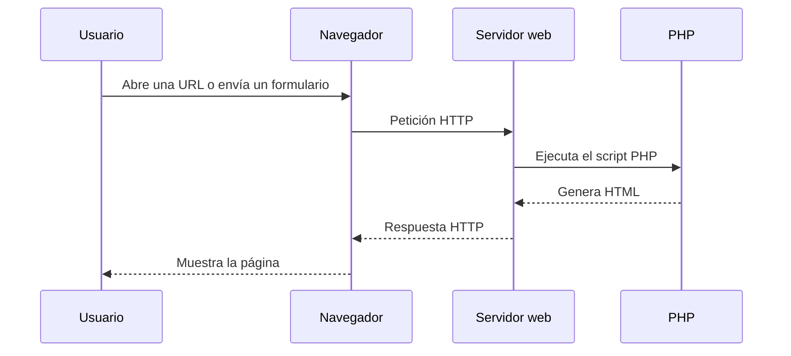

# UT2. Programación web en servidor con PHP

## Presentación de la unidad

En esta unidad aprenderemos a diseñar una web **capaz de procesar información antes de responder**.
En la UT1, hemos montado y configurado un entorno web reproducible con una aplicación web de prueba. A partir de aquí empezamos a construir páginas que:

- reciben datos del usuario;
- toman decisiones en el servidor;
- generan HTML dinámico;
- recuerdan información entre peticiones;
- restringen el acceso a usuarios autenticados.

La idea principal no es “aprender PHP por aprender PHP”, sino entender qué ocurre en una aplicación web real cuando el navegador envía una petición, el servidor ejecuta código y devuelve una respuesta.

---

## Pregunta guía de la unidad

> **¿Qué ocurre entre que el usuario pulsa “Enviar” y aparece la siguiente página en pantalla?**

Si entiendes bien esa pregunta, entiendes la base de toda la UT.

---

## Resultado de aprendizaje trabajado

### RA5. Genera documentos web utilizando lenguajes de guiones de servidor.

### Criterios de evaluación del RA

1. Se han identificado los lenguajes de guiones de servidor más relevantes.  
2. Se ha reconocido la relación entre los lenguajes de guiones de servidor y los lenguajes de marcas utilizados en los clientes.  
3. Se ha reconocido la sintaxis básica de un lenguaje de guiones concreto.  
4. Se han utilizado estructuras de control del lenguaje.  
5. Se han definido y utilizado funciones.  
6. Se han utilizado formularios para introducir información.  
7. Se han establecido y utilizado mecanismos para asegurar la persistencia de la información entre distintos documentos web relacionados.  
8. Se ha identificado y asegurado a los usuarios que acceden al documento web.  
9. Se ha verificado el aislamiento del entorno específico de cada usuario.

---

## Qué vas a aprender

Al terminar esta unidad deberías ser capaz de:

- explicar qué papel tiene PHP dentro de una arquitectura web real;
- distinguir claramente qué ocurre en el cliente y qué ocurre en el servidor;
- escribir scripts PHP sencillos y legibles;
- usar variables, arrays, condicionales, bucles y funciones;
- procesar formularios HTML con `GET` y `POST`;
- validar datos enviados por el usuario;
- usar cookies y sesiones para mantener información entre peticiones;
- construir una zona privada con login y logout;
- comprobar que cada usuario mantiene su propio estado.

---

## Relación con el módulo

### Vienes de la UT1
En la UT1 montaste un entorno reproducible y entendiste cómo desplegar y ejecutar una aplicación web de forma ordenada.

### Ahora, en la UT2
Aprendes la lógica del lado del servidor con PHP.

### Después, en la UT3
Conectarás PHP con una base de datos para almacenar información de forma persistente.

---

## Duración y organización

- **24 horas en centro**
- **12 sesiones de 2 horas**

Secuencia orientativa de trabajo:

1. Lenguajes de servidor, arquitectura cliente/servidor, ciclo petición-respuesta, preparación del entorno y primeros scripts PHP con HTML (mini ejercicios 1 a 3).
2. Variables, tipos de datos, operadores y arrays, con el mini ejercicio 4.
3. Estructuras de control I: condicionales `if` / `elseif` / `else`, operador ternario y `switch` (mini ejercicios 5 a 8).
4. Estructuras de control II: bucles `for` y `while`, y recorrido de arrays con `foreach` (mini ejercicios 9 a 14).
5. Funciones y formularios HTML: definición, parámetros, valores de retorno, estructura de un formulario, `GET`, `POST` y lectura segura de datos (mini ejercicio 15).
6. Procesamiento de formularios: comprobación del método, validación en servidor, mensajes de error, conservación de valores y ejemplo completo (mini ejercicio 16).
7. Persistencia entre peticiones: límites de las variables normales, cookies, sesiones, cabeceras y redirecciones (mini ejercicio 17).
8. Autenticación básica, protección de rutas, cierre de sesión, aislamiento entre usuarios y depuración de errores frecuentes (mini ejercicios 18 y 19).
9. Práctica 1: creación del formulario de presupuesto, recogida de datos y validación en servidor.
10. Práctica 1: cálculo del presupuesto, generación de la respuesta dinámica, pruebas y corrección de errores.
11. Práctica 2: implementación del login, autenticación, creación de la sesión y protección del panel privado.
12. Práctica 2: estado propio por usuario, cierre de sesión, prueba de aislamiento, validación final y cierre de la unidad.

---

## Contenidos de la unidad

1. Qué es un lenguaje de servidor y por qué se usa.  
2. PHP dentro del ciclo petición-respuesta.  
3. Sintaxis básica y mezcla con HTML.  
4. Variables, arrays y operadores.  
5. Estructuras de control.  
6. Funciones.  
7. Formularios y validación.  
8. Cookies y sesiones.  
9. Autenticación básica y aislamiento por usuario.  
10. Depuración y errores frecuentes.

---

## Idea clave: cliente y servidor no hacen lo mismo

### Conclusión importante

- **El navegador interpreta HTML, CSS y JavaScript.**
- **El servidor ejecuta PHP.**
- El usuario nunca recibe el código PHP: recibe el resultado que ese código ha generado.

---

## Herramientas que usaremos

- **PHP**
- **HTML**
- **formularios HTTP**
- **cookies y sesiones**
- **VS Code**
- **entorno montado en la UT1**
- **logs y depuración básica**

---

## Qué no vamos a hacer todavía

En esta unidad **todavía no** vamos a:

- conectar con MySQL o MariaDB;
- trabajar con frameworks;
- diseñar una arquitectura avanzada;
- aplicar medidas de seguridad de nivel producción.

La prioridad aquí es construir una base clara y sólida antes de añadir más complejidad.

---

## Qué serás capaz de construir al final

Al terminar la unidad podrás desarrollar una miniaplicación PHP con:

- una o varias páginas HTML/PHP;
- formularios que envían datos por `GET` o `POST`;
- validación básica de entrada;
- funciones reutilizables;
- almacenamiento temporal de información por sesión;
- acceso privado con usuario y contraseña;
- cierre de sesión y control de acceso.

---

## Productos de trabajo de la unidad

### Práctica 1
Una miniaplicación con:

- formulario;
- validación;
- funciones;
- respuesta dinámica generada por PHP.

### Práctica 2
Una pequeña zona privada con:

- login;
- sesión;
- control de acceso;
- logout;
- persistencia por usuario.

---

## Errores típicos que vamos a combatir

- pensar que PHP se ejecuta en el navegador;
- confundir `GET` y `POST`;
- usar `$_POST` o `$_GET` sin comprobar antes si existe la clave;
- olvidar `session_start()`;
- creer que una variable normal se conserva entre peticiones;
- enviar salida antes de usar redirecciones o cabeceras;
- guardar contraseñas en texto plano;
- pensar que dos usuarios comparten la misma sesión.

---

## Cómo se evaluará

La evaluación combinará:

- ejercicios;
- prácticas guiadas;
- cuestionarios;
- exámenes;

Se valorará especialmente que el alumnado:

- **entienda** el flujo completo;
- **explique** lo que ha hecho;
- **modifique** su solución cuando se le plantee una pequeña variante;
- **detecte y corrija** errores básicos de implantación y programación.

---

## Consejo de trabajo para esta UT

Conviene pensar siempre en este orden:

1. ¿Qué datos llegan al servidor?  
2. ¿Dónde los leo en PHP?  
3. ¿Qué decisión toma el script?  
4. ¿Qué HTML se genera?  
5. ¿Qué información debe mantenerse entre una petición y la siguiente?

Si respondes bien a esas cinco preguntas, casi siempre sabrás cómo avanzar.

---

## Resultado esperado al finalizar

Si haces bien esta unidad, llegarás a la UT3 con una base muy sólida para entender que una base de datos no es “la aplicación”, sino una pieza más dentro de un flujo web que ya sabrás controlar.
