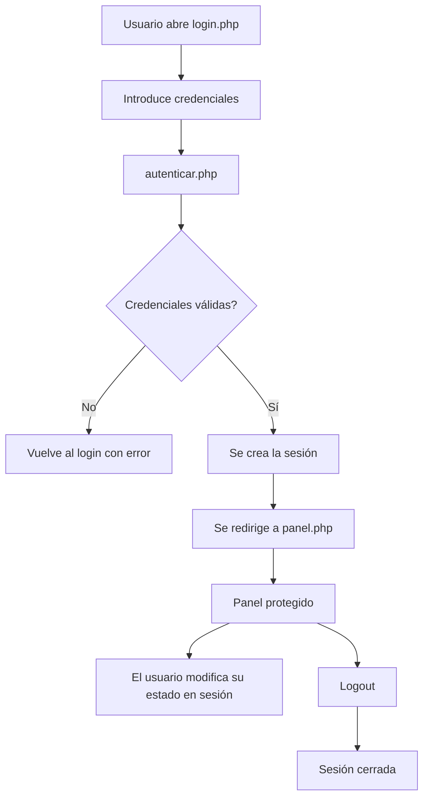

# Práctica 2 · Zona privada con login, sesión y aislamiento por usuario

## 1. Qué vas a construir

Vas a desarrollar una miniaplicación PHP con autenticación básica, sesión, panel privado y cierre de sesión.

La idea clave de esta práctica es entender que HTTP no recuerda por sí solo quién es cada usuario, y que por eso la aplicación necesita mecanismos de persistencia y control de acceso.

---

## 2. Qué demuestra esta práctica

Con esta práctica debes demostrar que sabes:

- procesar formularios de acceso;
- validar credenciales;
- abrir y usar una sesión;
- proteger una ruta privada;
- cerrar sesión correctamente;
- comprobar que cada usuario mantiene su propio estado.

### Criterios del RA5 trabajados

- **CE6**. Uso de formularios.
- **CE7**. Persistencia de información entre documentos web relacionados.
- **CE8**. Identificación y aseguramiento de usuarios.
- **CE9**. Verificación del aislamiento del entorno específico de cada usuario.

También reaparecen:

- **CE3**. Sintaxis básica.
- **CE4**. Estructuras de control.
- **CE5**. Funciones.

---

## 3. Contexto funcional

Una empresa quiere una pequeña intranet de prueba sin base de datos. De momento solo necesita comprobar que:

- un usuario puede iniciar sesión;
- el panel privado está protegido;
- la aplicación recuerda al usuario autenticado;
- cada usuario mantiene su propio estado.

En la UT3 ya se dará el salto a persistencia con base de datos. Aquí nos centramos en el mecanismo web básico.

---

## 4. Requisitos obligatorios

Tu aplicación debe incluir, como mínimo:

### Login
- campo de usuario;
- campo de contraseña.

### Autenticación
- si las credenciales son válidas, se inicia sesión;
- si no lo son, se muestra un error claro.

### Panel privado
Debe mostrar, al menos:

- el nombre o identificador del usuario autenticado;
- un mensaje de bienvenida;
- información guardada en `$_SESSION`.

### Acción propia del usuario
Dentro del panel, el usuario debe poder modificar su propio estado. Por ejemplo:

- guardar una preferencia;
- añadir notas rápidas;
- incrementar un contador de accesos;
- guardar un color favorito.

### Logout
- debe cerrar la sesión de verdad.

### Protección de acceso
- si alguien intenta abrir el panel sin sesión, no debe entrar.

---

## 5. Requisitos técnicos mínimos

### Obligatorio

- uso de `session_start()`;
- almacenamiento de datos en `$_SESSION`;
- comprobación de acceso en el servidor;
- prueba real de aislamiento entre dos usuarios o dos contextos de navegador;
- uso de contraseñas verificadas con un enfoque razonable para esta UT.

### En esta UT se permite

Como todavía no trabajamos con base de datos, puedes usar un pequeño repositorio simulado de usuarios directamente dentro de `autenticar.php`:

```php
$usuarios = [
    'ana' => [
        'nombre' => 'Ana',
        'password_hash' => '...'
    ],
    'marcos' => [
        'nombre' => 'Marcos',
        'password_hash' => '...'
    ]
];
```

La validación de contraseña puede hacerse con `password_verify()` sobre hashes ya preparados.

---

## 6. Estructura orientativa

```text
practica-2/
├── login.php
├── autenticar.php
├── panel.php
├── logout.php
└── README.md
```

Dentro del repositorio privado del módulo, esta práctica debe quedar en `unidades/UT2/practica-2/`.


---

## 7. Flujo esperado



---

## 8. Funcionalidad recomendada

Para que la práctica sea homogénea y fácil de evaluar, se recomienda este caso:

### Panel privado de notas rápidas
Cada usuario autenticado puede:

- ver su nombre;
- ver cuántas veces ha entrado al panel;
- guardar hasta 3 notas breves en su sesión;
- cerrar sesión.

Con esta opción demuestras bien:

- login;
- persistencia;
- escritura y lectura en `$_SESSION`;
- aislamiento entre usuarios.

---

## 9. Prueba mínima de aislamiento

Este punto es obligatorio.

Debes demostrar una de estas dos situaciones:

### Opción A
Un usuario guarda una nota y otro usuario no la ve.

### Opción B
Un usuario incrementa su contador y el otro mantiene un contador distinto.

Puedes probarlo con:

- dos navegadores distintos;
- ventana normal e incógnito;
- dos perfiles de navegador.

---

## 10. Entrega

Debes entregar esta práctica dentro de tu repositorio privado del módulo, en la ruta `unidades/UT2/practica-2/`.

La entrega mínima debe incluir:

- código fuente completo del proyecto;
- `README.md` breve con estructura, usuarios de prueba, decisiones tomadas y pasos exactos para ejecutar la práctica;
- capturas de:
  - login correcto,
  - login incorrecto,
  - acceso al panel,
  - intento de acceso sin autenticación,
  - logout;
- una captura o explicación breve de la prueba de aislamiento.


---

## 11. Errores típicos a evitar

### Olvidar `session_start()`

Si no llamas a `session_start()`, `$_SESSION` no se comportará como esperas.

### Proteger solo la navegación visible

Ocultar un enlace no protege una página. La comprobación debe hacerse en el servidor.

### Hacer un logout incompleto

Si el cierre de sesión deja restos del estado anterior, el comportamiento será confuso.

### No probar aislamiento real

Probar solo con una pestaña no demuestra bien el criterio de aislamiento por usuario.

### Guardar contraseñas en texto plano en el flujo principal

Aunque sea una práctica, conviene acostumbrarse desde ya a usar hashes o una simulación razonable.

---

## 12. Ampliaciones opcionales

Si acabas antes, puedes añadir:

- regeneración del identificador de sesión tras el login;
- última hora de acceso;
- cookie de preferencia visual;
- mensaje flash;
- varias páginas protegidas.

---

## 13. Cómo se evaluará esta práctica


El profesor valorará dos cosas:

1. **el producto entregado y su funcionamiento**, de acuerdo a las indicaciones de este enunciado;
2. **una validación breve de autoría y comprensión**, en clase o por videollamada.

En esa validación se te puede pedir que:

- ejecutes la aplicación;
- enseñes qué guardas en `$_SESSION`;
- señales cómo proteges `panel.php`;
- expliques la diferencia entre cookie y sesión;
- hagas una mini modificación, por ejemplo:
  - añadir un usuario nuevo,
  - mostrar la hora del último acceso,
  - añadir un contador de visitas,
  - guardar una preferencia adicional,
  - cambiar la condición de acceso al panel.


---

## 14. Checklist del alumno antes de entregar

- [ ] Uso `session_start()` donde corresponde.
- [ ] El panel privado no se abre sin sesión.
- [ ] El login correcto funciona.
- [ ] El login incorrecto muestra error.
- [ ] Guardo información útil en `$_SESSION`.
- [ ] El logout cierra la sesión.
- [ ] He probado el aislamiento con dos contextos distintos.
- [ ] He documentado en `README.md` cómo ejecutar la práctica.
- [ ] He subido la práctica a mi repositorio privado del módulo.
- [ ] Soy capaz de explicar mi flujo y hacer una modificación pequeña.
